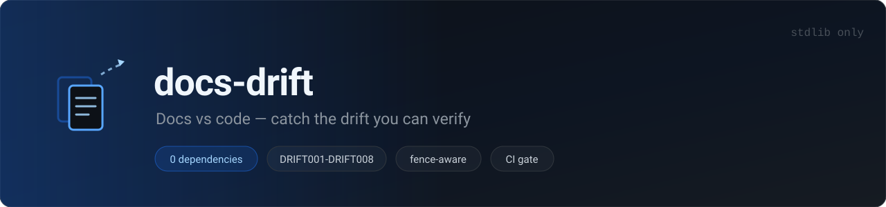
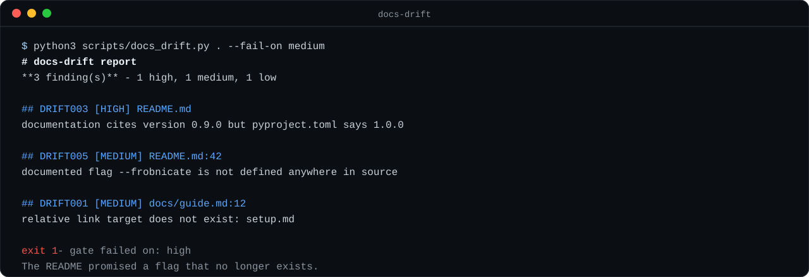

# docs-drift



[](#tests)
[](#)
[](#)
[](LICENSE)

**Find where your documentation stopped matching your code — the part that's mechanically checkable.**

Point it at a repo; it compares markdown against the actual source tree and reports the concrete mismatches: dead links, broken anchors, version numbers that disagree with the manifest, identifiers and CLI flags mentioned in the docs that no longer exist in source, a CHANGELOG missing an entry for the current version. Each with a file and line. No network, no rewriting, no prose opinions.

> This is a [Claude / Agent Skill](https://claude.com/docs): a `SKILL.md` file plus helper scripts that an AI agent can load and run. Drop the folder into your skills directory and ask "is my README still accurate after this refactor?"



## Why

A README is a promise about the code. Refactors silently break it: a flag gets renamed, a function is deleted, the version badge is never bumped, a link rots in a moved file. Nothing fails, so nobody notices until a user follows the docs and hits a wall. `docs-drift` turns "our docs might be stale" into a concrete, line-numbered list.

## Quick start

```bash
# check the current repo
python3 scripts/docs_drift.py .

# machine-readable
python3 scripts/docs_drift.py . --format json

# CI gate: fail on anything medium or worse
python3 scripts/docs_drift.py . --fail-on medium

# widen the source globs if your code isn't *.py/*.js/...
python3 scripts/docs_drift.py . --source "*.rb" --source "lib/**/*.rb"

# silence a noisy rule or a path
python3 scripts/docs_drift.py . --ignore DRIFT004 --ignore vendor/
```

Standard library only (Python 3.8+). No `pip install`.

## Rules

| Rule | Severity | Meaning |
|------|----------|---------|
| DRIFT001 | medium | Relative link target does not exist |
| DRIFT002 | low | Anchor has no matching heading |
| DRIFT003 | high | Doc version disagrees with the manifest |
| DRIFT004 | low | Identifier in inline code not found in source |
| DRIFT005 | medium | Documented CLI flag not defined in source |
| DRIFT006 | low | CHANGELOG has no entry for the current version |
| DRIFT007 | info | Duplicate heading in one document |
| DRIFT008 | info | A line starts with a stale marker (TODO/FIXME/TBD/WIP) |
| DRIFT000 | info | No markdown documentation found |
| DRIFT010 | info | No source files found; symbol/flag checks skipped |

Code fences are masked before any structure is parsed, so a `## Heading` or a `[link](x)` inside a code sample is never treated as real documentation — and a 4-backtick fence is not closed early by a 3-backtick line inside it. Links inside inline code are ignored for the same reason, and URL-encoded targets (`my%20doc.md`) resolve correctly. DRIFT004 and DRIFT005 are deliberately heuristics and marked low/medium; everything else is exact.

## Output and exit codes

- **markdown** (default): root, a severity tally, then one section per finding with rule id, severity, `path:line`, message, and a suggested fix.
- **json**: `{tool, version, root, summary, findings[]}` — stable shape for CI.

Exit codes: `0` clean or below `--fail-on`; `1` a finding at or above `--fail-on`; `2` usage/IO error.

## Scopes it on purpose

`docs-drift` reads files and prints a report — it never edits a file, never rewrites prose, and never "tidies" a README. It does not judge tone, clarity, grammar, or whether a claim is *true*, only whether links resolve, versions match, and named symbols exist. It is **not** a plagiarism or similarity checker, and must not be used to detect or evade one. See `SKILL.md` → *Guardrails*.

## CI

```yaml
- run: python3 scripts/docs_drift.py . --fail-on medium
```

## Tests

```bash
python3 -m unittest discover -s tests      # zero-dependency
# or:  pytest tests/
```

31 tests covering every rule, the anchor slugging, code-fence masking (including nested and `~~~` fences), URL-decoding, the CHANGELOG exemption, and the CLI contract (exit codes, `--ignore`, `--fail-on`, JSON shape). Everything runs offline against temporary fixture repos.

## Repo layout

```
SKILL.md                       # the skill: when to use, how, guardrails
scripts/docs_drift.py          # the checker (stdlib only)
tests/test_docs_drift.py       # unittest suite (offline)
assets/                        # banner + demo (SVG)
CHANGELOG.md
.github/workflows/ci.yml       # tests on 3.9 / 3.11 / 3.12
```

## 中文简介

`docs-drift` 是一个 Agent Skill：拿你的 markdown 文档和源码树对一遍，把**机械可验证**的漂移点报出来——死链、失效锚点、文档里的版本号与 manifest 不一致、文档提到的标识符/命令行 flag 在源码里已经不存在、CHANGELOG 缺当前版本的条目。解析前会屏蔽代码块，所以示例里的 `## 标题` 或 `[链接](x)` 不会被当成真实文档结构。只用 Python 标准库，零依赖；**只读、不改写文字**，也不做查重降重。把文件夹放进你的 skills 目录，然后问 agent"重构之后我的 README 还准吗"即可。

## License

MIT
